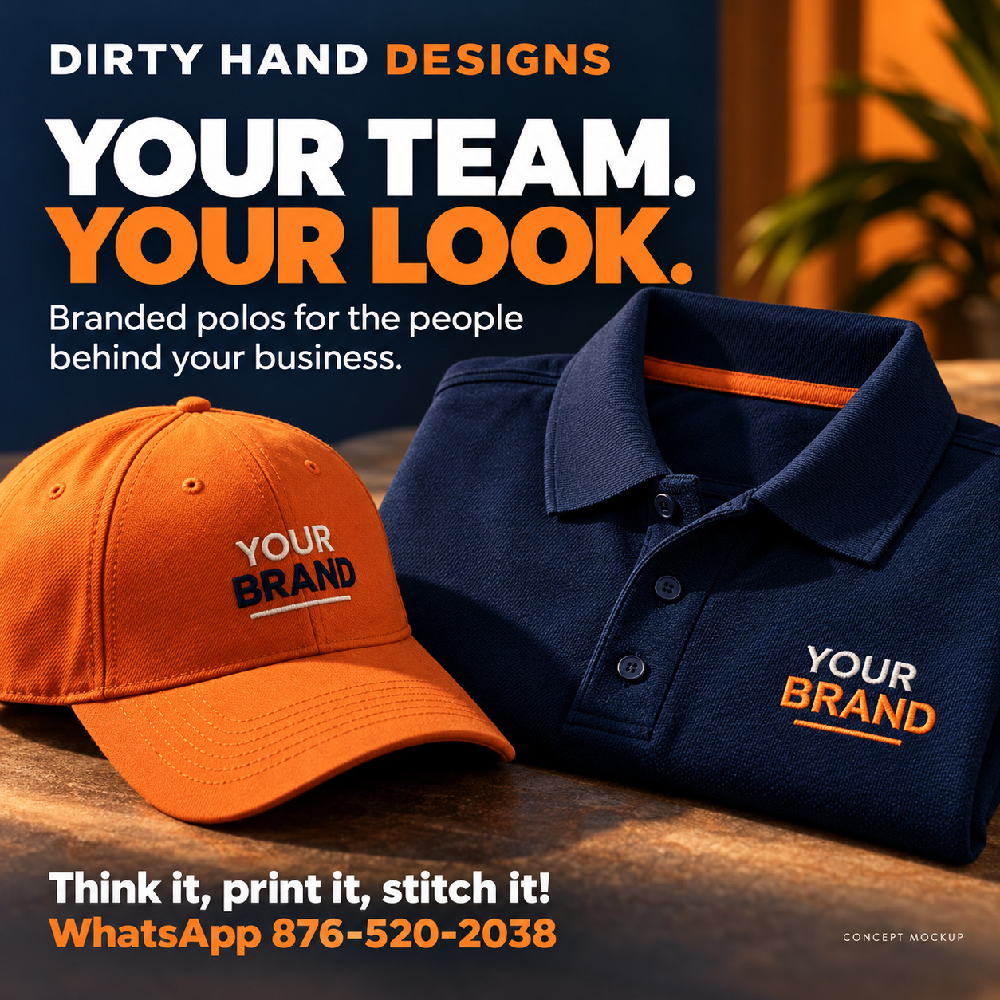
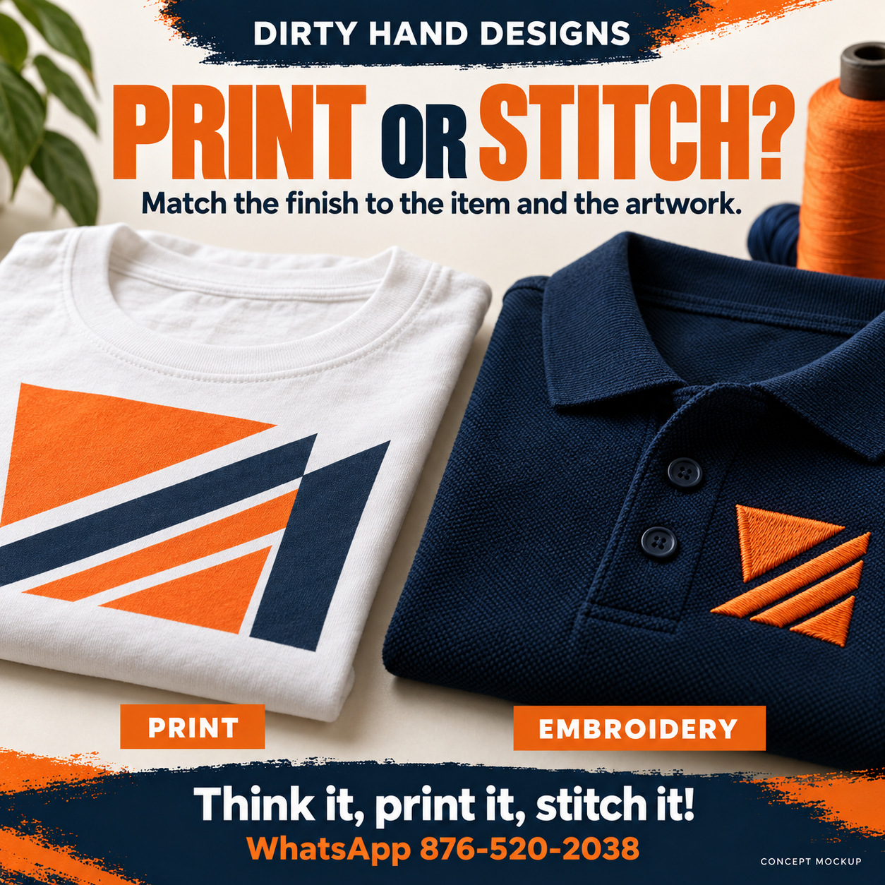
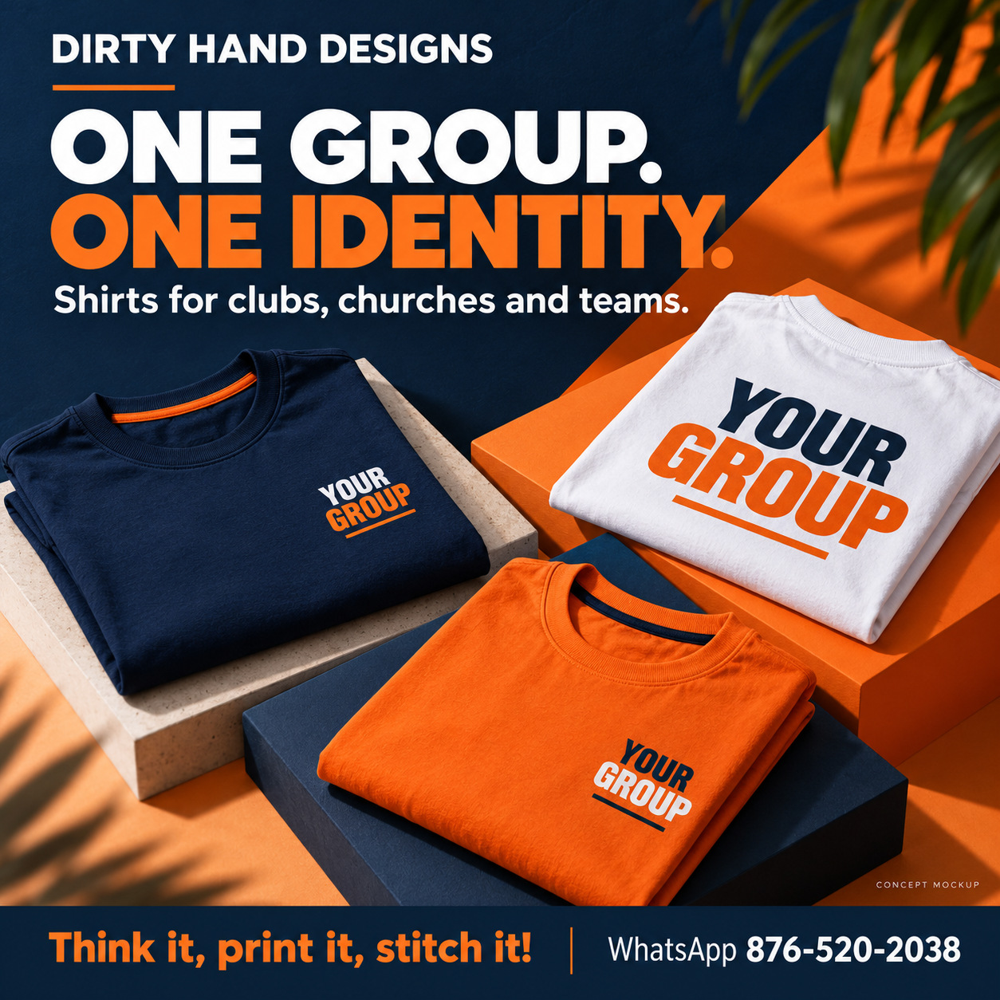
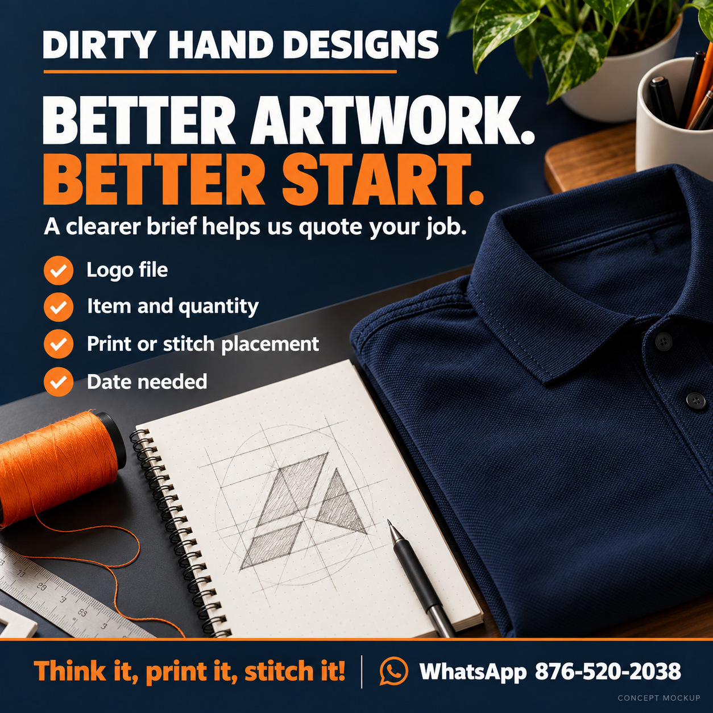
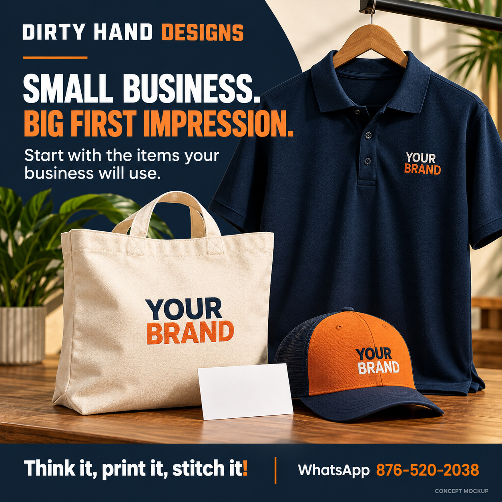

# DHD pilot — visual review

Drafts only. Six generated concept images and twelve tailored captions. Proposed times use America/Jamaica. All artwork and copy require owner review.

## DHD-PILOT-001 — Your team. Your look.

### instagram · proposed 2026-10-26T12:30:00-05:00

Your team should look like your team.

A coordinated polo and cap can help customers recognise the people behind your business. Start with the items your staff will actually wear, then choose the logo placement and finish.

WhatsApp 876-520-2038 with your logo, item and quantity for a quotation.

Concept mockup; final items and branding are agreed with your quotation.

#DirtyHandDesigns #BusinessBranding #Jamaica

### facebook · proposed 2026-10-26T18:30:00-05:00

Make your team easier to recognise.

Planning uniforms for your business? Dirty Hand Designs can help you choose branded polos and caps, with printing or embroidery suited to the job.

Request a quotation on WhatsApp: https://wa.me/18765202038
Send your logo, preferred items and quantities.

Concept mockup; final items and branding are agreed with your quotation.

## DHD-PILOT-002 — Print or stitch?

### instagram · proposed 2026-10-28T12:30:00-05:00

The right finish starts with the right question.

What are you branding, and how will it be used?

Print can suit bold artwork and larger graphics. Embroidery gives suitable garments a stitched finish, often used for chest logos and caps. Small lettering, artwork detail, fabric and placement all affect the choice.

Save this before your next branded order.

Concept samples shown; the finish is confirmed after artwork and item review.

#DirtyHandDesigns #PrintAndStitch #Jamaica

### facebook · proposed 2026-10-28T18:30:00-05:00

Printing or embroidery? Start with the item and the artwork.

A bold graphic on a T-shirt and a small chest logo on a polo may call for different finishes. Fabric, design detail, lettering size and placement matter.

These concept samples illustrate the difference; artwork and garment review determine what will work for your job.

Save this guide for your next branded order.

## DHD-PILOT-003 — One group. One identity.

### instagram · proposed 2026-10-30T12:30:00-05:00

Different people. One group look.

For your club, church or team, coordinated shirts can bring the group identity together. A clear quantity, size list and artwork brief make the quotation easier to prepare.

WhatsApp 876-520-2038 with your group name, quantities and date needed.

Concept mockups shown; colours, styles and availability are confirmed in your quotation.

#DirtyHandDesigns #GroupShirts #Jamaica

### facebook · proposed 2026-10-30T18:30:00-05:00

Bring your group identity together.

Planning shirts for a church, club or team? Prepare your artwork, quantities, size list and date needed so we can assess the job and quote clearly.

Start your group enquiry: https://wa.me/18765202038

Concept mockups shown. Final colours, styles, availability and production timing require confirmation.

## DHD-PILOT-004 — Better artwork. Better start.

### instagram · proposed 2026-11-02T12:30:00-05:00

Four details that help us understand your job.

1. Your clearest available logo file.
2. The item and quantity.
3. Where you want the branding placed.
4. The date you need the finished order.

A screenshot may not show enough detail for production. Send the original artwork if you have it; we will review what is suitable before the job is confirmed.

Save this checklist for your next quotation.

Concept workspace illustration.

#DirtyHandDesigns #BrandingTips #Jamaica

### facebook · proposed 2026-11-02T18:30:00-05:00

A useful quotation starts with a clear brief.

Have these ready:
• Your clearest available logo file.
• The item and quantity.
• The branding placement.
• The date needed.

Send original artwork where available. We still need to review the artwork, items and production requirements before confirming the job.

Save this checklist for your next quotation.

Concept workspace illustration.

## DHD-PILOT-005 — Your brand. Beyond the shirt.

### instagram · proposed 2026-11-04T12:30:00-05:00

Where else could your brand show up?

A cap for the team. A mug for the desk. A bag that gets used again.

Choose merchandise around the people receiving it and how they will use it. Artwork, material and available stock determine the branding options.

Save this idea for your next team or customer-gift brief.

Concept mockups shown; products and finishes require confirmation.

#DirtyHandDesigns #BrandedMerchandise #Jamaica

### facebook · proposed 2026-11-04T18:30:00-05:00

Choose branded items people have a reason to use.

Caps, mugs and bags offer different ways to carry a business identity. Think about the recipient and the occasion before building a merchandise package.

Availability, artwork and materials affect the final options.

Save this idea for your next team or customer-gift brief.

Concept mockups shown; final products and branding require confirmation.

## DHD-PILOT-006 — Small business. Big first impression.

### instagram · proposed 2026-11-06T12:30:00-05:00

Your first branded items should earn their place.

Start with what your business will use: a polo for customer-facing work, a cap for the team, or a bag that fits the job. Build from your needs and budget rather than buying a little of everything.

WhatsApp 876-520-2038 to discuss a starter branding quotation.

Concept kit shown, not a fixed-price package. Items and availability are confirmed individually.

#DirtyHandDesigns #SmallBusinessJamaica #BusinessBranding

### facebook · proposed 2026-11-06T18:30:00-05:00

Starting a business? Build a practical first impression.

Choose the branded items that fit how you work. A customer-facing team may need polos; another business may find caps or bags more useful.

Discuss a starter branding quotation on WhatsApp: https://wa.me/18765202038

This is a concept kit, not a fixed-price package. Product availability, artwork, quantities and final pricing require confirmation.

